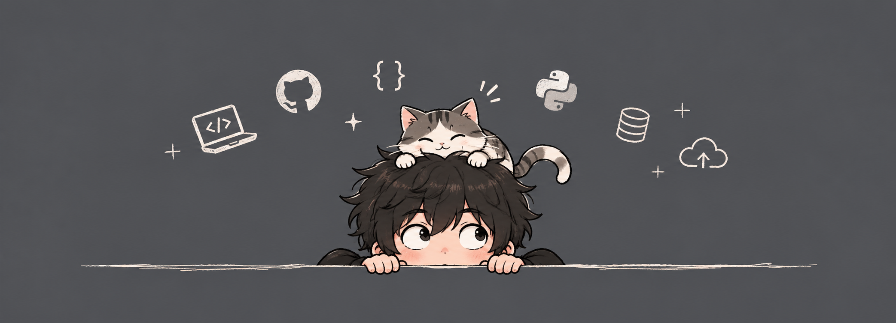

# Hello, I'm Dhanush! ^._.^

[+%40+Amity+Bengaluru;Not+all+those+who+wander+are+lost)](https://github.com/Dhanush-2110)

---

### 👋 About
- 💻 Interested in coding and design
- 🌱 Currently learning AIML, cloud and microservices
- 🤝 Looking to collaborate on open source
- ⚡ Fun fact: I love building websites and full-stack apps

### 🛠️ Tech Stack

### 📊 GitHub Stats

 

### 📈 Activity Graph

### 🚀 Currently Building
- 🛍️ AI Fashion App (Next.js + NestJS)
- 🏭 Sew Ops, a garment factory production monitoring app

### 🏆 Trophies

### 🐍 Contribution Snake

`build · learn · improve`

